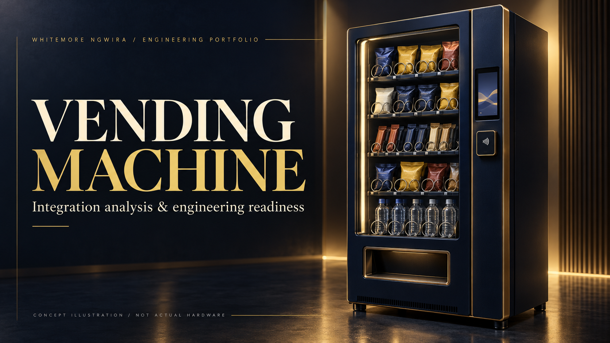

# Vending Machine

### Integration analysis & engineering readiness

**Whitemore Ngwira · Sweet Robo · Selected engineering contributions**

*AI-generated concept illustration. The equipment and interface shown are fictional; they are not photographs or screenshots of Sweet Robo products.*

## At a glance

I carried out technical investigation and integration planning for vending-machine software during my work at Sweet Robo, translating hardware questions into software requirements and a practical validation plan.

**Focus:** Systems analysis and integration planning  
**Skills demonstrated:** Android systems · Hardware/software integration · Technical research · Test planning · Engineering documentation

## The engineering challenge

A payment terminal's advertised capability is only one part of an unattended vending integration. Application support, the hardware interface and a real-machine test all need to agree before a compatibility claim is justified.

## My contribution

### Compatibility investigation

I compared terminal documentation with the application’s existing integration capabilities to distinguish supported behaviour from work still required.

### Implementation scoping

I evaluated opportunities to reuse existing engineering work and identified the adaptation needed for a vending workflow.

### Validation planning

I identified the software, hardware and provider confirmations needed before a real-machine integration could be accepted.

### Technical communication

I prepared a concise integration assessment and supporting learning documentation so the next engineering decision had a clear basis.

## How I approached the work

*Illustrative investigation process; not a wiring diagram or proprietary integration specification.*

1. Review requirements.
2. Assess compatibility.
3. Scope the adaptation.
4. Define validation.

## What the work produced

The work produced an integration assessment, an implementation outline and a defined hardware-validation boundary.

This showcase covers analysis and preparation. It does not claim that I implemented or deployed the proposed vending payment integration.

## Public review boundary

This is a documentation-only portfolio showcase. Private source code, internal platform names, infrastructure, endpoints, schemas, credentials, customer information, operational records and internal screenshots are excluded. Supporting work records remain private.

The narrative explains my contribution within a team-owned product. The concept artwork is not evidence of implementation or an employer-approved product design.

## Explore the series

- [Perfume Machine](https://github.com/whitemorengwira/sweet-robo-perfume-machine)
- [Photo Booth](https://github.com/whitemorengwira/sweet-robo-photo-booth)
- [Control Centre Engineering](https://github.com/whitemorengwira/sweet-robo-control-centre-engineering)

## Contact

[GitHub profile](https://github.com/whitemorengwira) · [N.White Systems](https://nwhite.systems/) · [Email Whitemore](mailto:hello@nwhite.systems)

I can discuss my engineering approach and responsibilities within the applicable confidentiality boundaries.

See [Portfolio viewing notice](COPYRIGHT.md).

