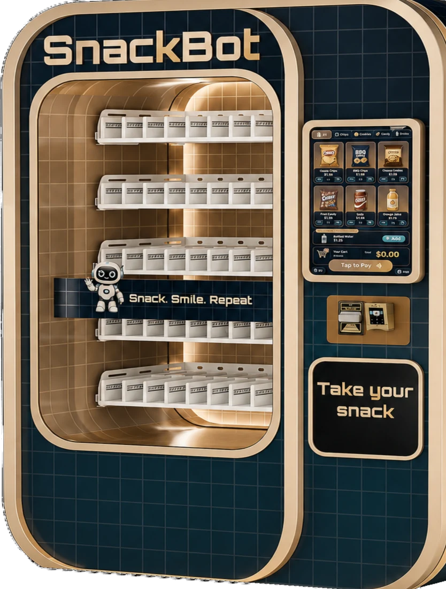
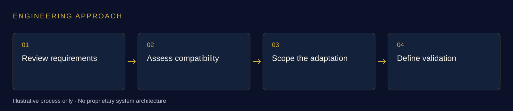

# Vending Machine

### Hardware–software integration analysis for automated retail

**Whitemore Ngwira · Engineering contributions at Sweet Robo**

[Sweet Robo — official website](https://sweetrobo.com/) · [Futureino — official website](https://futureino.ai/) · [Explore the public product page](https://futureino.ai/best-vending-machines)

  

*Futureino’s published Snacks Bot product visual. [View source image](https://futureino.ai/machines/snacks-bot-lux.webp).*

## My work

During my work at Sweet Robo, I investigated vending-machine integration requirements and translated hardware questions into a practical software scope and validation plan.

**Skills:** Android systems · Hardware–software integration · Technical research · Test planning

## The product context

Futureino’s public vending range includes Snacks Bot, described with a touchscreen, an elevator-assisted dispensing mechanism, a collection window and remote inventory monitoring. [Official source](https://futureino.ai/best-vending-machines).

## My engineering contributions

- **Compatibility assessment:** Compared public terminal documentation with the application’s integration capabilities to identify what was supported and what still needed development.
- **Engineering scope:** Evaluated reusable engineering components and the adaptations needed for a vending workflow.
- **Validation planning:** Defined the hardware, application and payment-provider confirmations needed before making a compatibility commitment.
- **Decision support:** Prepared a concise technical assessment and supporting documentation to guide implementation planning.

## What I produced

An integration assessment, an implementation outline and a concrete set of validation prerequisites. This contribution covers investigation and planning; it is not a claim that the proposed integration was deployed.

## Engineering approach

Connecting hardware documentation, software constraints and operational requirements into an engineering decision that a team can act on.

## AI-assisted engineering

Across my connected-machine work, I use **Claude Code** and **OpenAI Codex** to support code understanding, scoped changes, debugging, verification and technical documentation. I direct the work, review the output and distinguish software checks from physical-machine acceptance.

[See how I use Claude Code and Codex in my engineering workflow](https://github.com/whitemorengwira#software-engineering-with-claude-code--codex). This describes my development method; it does not expose internal agent instructions or proprietary implementation details.

## Explore the engineering series

- [Perfume Machine](https://github.com/whitemorengwira/sweet-robo-perfume-machine)
- [Vending Machine](https://github.com/whitemorengwira/sweet-robo-vending-machine) — this showcase
- [AI Photo Booth App](https://github.com/whitemorengwira/sweet-robo-photo-booth) — AI-powered application engineering
- [Control Centre Engineering](https://github.com/whitemorengwira/sweet-robo-control-centre-engineering) — AI-powered management, remote diagnostics and camera-AI workflows

## Sources and portfolio scope

Official product information and imagery: [Futureino](https://futureino.ai/) and [Sweet Robo](https://sweetrobo.com/). Product descriptions are attributed public context; the first-person contribution statements describe my own work within an existing team.

This documentation-only portfolio excludes proprietary source code, private infrastructure and non-public operational information. It does not imply sole product authorship, employer endorsement or completion of every hardware and release milestone. See [image credits and viewing notice](COPYRIGHT.md).

[Contact me](mailto:hello@nwhite.systems) · [N.White Systems](https://nwhite.systems/) · [GitHub profile](https://github.com/whitemorengwira)
